# Olá, eu sou Samuel 👋

### Sistemas de Informação · Desenvolvimento Front-end · Robótica e Sistemas Embarcados

  
  
  
  

---

## Sobre mim

Sou graduando em **Sistemas de Informação pelo IFMA** e técnico em **Manutenção e Suporte em Informática pelo IEMA**. Integro a equipe universitária de robótica **Team Two Maramaker**, com experiência anterior na equipe **Autobots (IEMA - Cururupu)**. Tenho interesse em desenvolvimento de software, automação, robótica e sistemas embarcados.

## Atuação

- **Desenvolvedor Front-end - Lençóis Tecnologia** (estágio obrigatório, 2026).
- **Monitor em Sistemas Embarcados - EmbarcaTech** (bolsista, 2024-2026).
- **Manutenção e Suporte em Informática - Fórum Desembargador José Pires Sexto** (estágio obrigatório, 2022).

## Formação

- **Bacharelado em Sistemas de Informação** - IFMA, em andamento desde 2023.
- **Técnico em Manutenção e Suporte em Informática** - IEMA, 2020–2022.

## Conquistas em robótica e tecnologia

- 🥇 **FIRA Nacional 2025** - 1º lugar, Carro Autônomo.
- 🥈 **FIRA Estadual 2025** - 2º lugar, Carro Autônomo.
- 🥉 **FIRA Americans 2026** - 3º lugar, Carro Autônomo.
- 🥉 **RoboParty 2025** - 3º lugar, Robot Show.
- 🏅 **FIRA Nacional 2024** - 4º lugar, classificação para o Mundial.
- 🥇 **FIRA Estadual 2024** - 1º lugar, Labirinto.
- 🎟️ **Universo IF 2024** - credencial conquistada para participar da **RoboParty**, em Portugal.
- 🏅 **LNR 2024** - 4º lugar no Desafio de Entrega.
- 🥉 **OBFEP 2022** - medalha de bronze; **FIRA Nacional 2021** - duas medalhas de prata e uma de bronze.

## Idiomas

- **Português:** compreende, fala, lê e escreve bem.
- **Inglês:** compreende e lê bem; fala e escreve razoavelmente.

> Consulte o currículo acadêmico e profissional completo no **[Currículo Lattes](https://lattes.cnpq.br/2614892772305367)**.

## Tecnologias

  

## Contribuições

  

<picture>
  <source media="(prefers-color-scheme: dark)" srcset="https://raw.githubusercontent.com/samueldesaa/samueldesaa/output/github-contribution-grid-snake-dark.svg">
  <source media="(prefers-color-scheme: light)" srcset="https://raw.githubusercontent.com/samueldesaa/samueldesaa/output/github-contribution-grid-snake.svg">
  
</picture>

## Projetos

Confira meus projetos e repositórios no **[GitHub](https://github.com/samueldesaa?tab=repositories)**. Em breve, vou destacar aqui alguns dos trabalhos que melhor representam minha trajetória.

## Contato

- **LinkedIn:** [Samuel Chaves de Sá](https://www.linkedin.com/in/samuel-chaves-de-s%C3%A1-6805b91bb/)
- **E-mail:** [samueldsa03032005@gmail.com](mailto:samueldsa03032005@gmail.com)
- **Currículo Lattes:** [lattes.cnpq.br/2614892772305367](https://lattes.cnpq.br/2614892772305367)

---

*“Sempre evoluindo, um commit de cada vez.”* ✨

